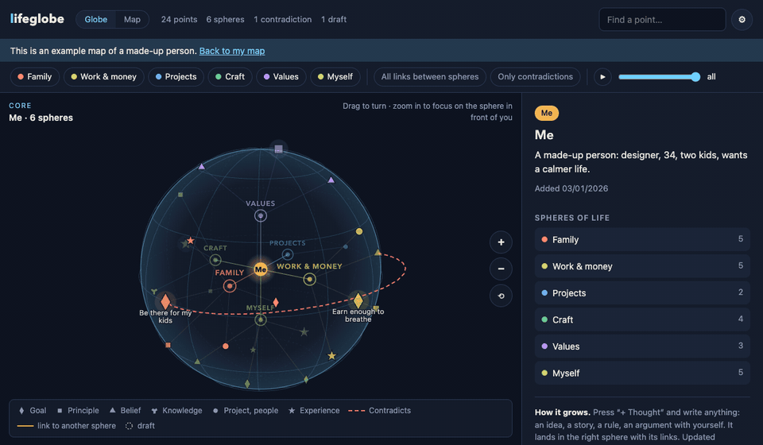

# lifeglobe

**See how your life fits together.** Work, family, health, values, goals — on one globe you can turn in your hands. Every thought becomes a point in a sphere of your life, linked to what it supports, what it follows from and what it pulls against.

It runs on **your own computer**. Your map is one file on your disk. No account, no cloud, no tracking.

*[Русская версия](README.ru.md)*



## Why

Life is not a list. A late meeting is about money, but also about the kids' dinner, your sleep and a promise you once made to yourself. Notes and to-do apps keep these things in separate boxes. lifeglobe puts them on one globe so you can *see* the threads:

- **Spheres of life** around you at the core — six by default, rename or recolour them as you like.
- **Points** — goals, principles, beliefs, experiences, projects, people — each in its sphere.
- **Links** with meaning: *follows from*, *confirms*, *part of*, *taught me*, *contradicts*.
- **Contradictions** shown in red. The AI asks you a few short questions and helps you resolve them in your own words.
- **Focus** — zoom in and the sphere in front of you stays sharp while the rest fades.
- **Timeline** — press ▶ and watch how your map grew.
- **A gentle start** — eight short questions, and your globe fills in as you answer.
- **A picture to share** — your globe as a story-sized image: points, spheres and counts, no personal text.

## Private by design

- The server listens on `127.0.0.1` only and refuses requests from other websites.
- The page makes no outside requests: no fonts, no CDNs, no analytics.
- AI is your choice:
  - **Ollama** (default) — the model runs on your computer; nothing leaves it.
  - **OpenAI** or **Claude** — with your own API key, stored only on your computer.
  - Or no AI at all: add points by hand.
- A backup is made on every save (`~/.lifeglobe/backups`). Export and import are one click.

## Start

You need Python 3.10 or newer.

```bash
pip install lifeglobe          # or: pipx install lifeglobe
lifeglobe                      # opens http://127.0.0.1:8765
```

From source:

```bash
git clone https://github.com/AppOsTool/lifeglobe
cd lifeglobe
python -m lifeglobe
```

### Local AI with Ollama (recommended)

1. Install Ollama from [ollama.com](https://ollama.com).
2. `ollama pull qwen2.5:7b` — a good multilingual model for an ordinary laptop. Pick a bigger one if your machine allows.
3. Start lifeglobe. That's it.

### OpenAI or Claude instead

Open ⚙ Settings, choose the provider and paste your key. For Claude also run `pip install "lifeglobe[claude]"`.

## Languages

English, Русский, Українська. Adding a language is one file: copy `lifeglobe/static/i18n/en.json`, translate the values, and send a pull request. The AI answers in the language you choose.

## Options

```
lifeglobe --port 8765 --data-dir ~/my-map --no-browser
```

## Develop

```bash
python -m unittest discover -s tests -t .
```

No dependencies, no build step: Python standard library on the server, plain JavaScript with [d3](https://d3js.org) (bundled) on the page.

## License

MIT. Made by [IT Apostol](https://github.com/AppOsTool).
