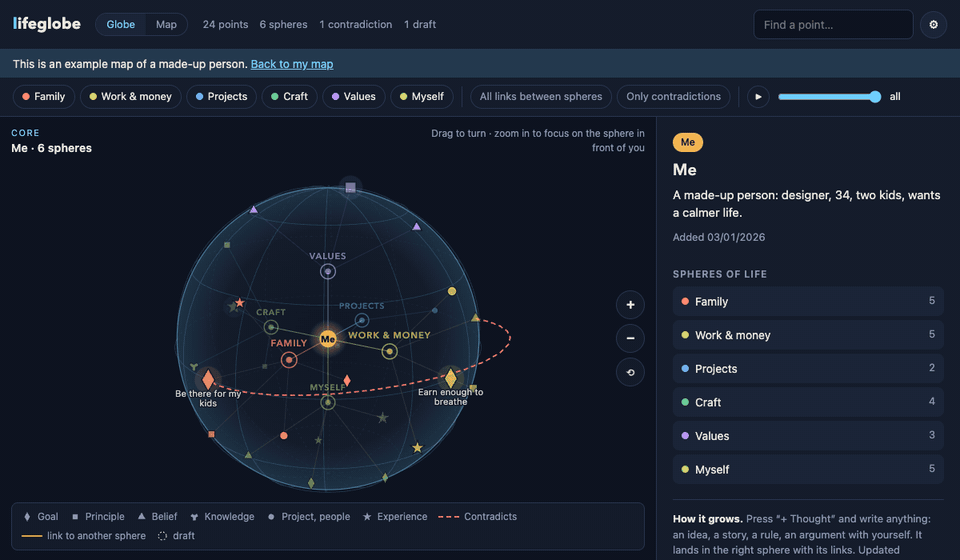

# lifeglobe

**Увидеть, как переплетена твоя жизнь.** Работа, семья, здоровье, ценности, цели — на одном шаре, который можно крутить в руках. Каждая мысль становится точкой в своей сфере жизни и связывается с тем, что она подтверждает, из чего вытекает и чему мешает.

Работает **на твоём компьютере**. Вся карта — один файл на диске. Без аккаунта, без облака, без слежки.

*[English version](README.md)*



## Зачем

Жизнь — не список. Поздняя встреча — это про деньги, но и про ужин с детьми, про твой сон и про обещание, которое ты когда-то себе дал. Заметки и списки дел раскладывают это по разным ящикам. lifeglobe кладёт всё на один шар, чтобы ты *видел* нити:

- **Сферы жизни** вокруг тебя в ядре — по умолчанию шесть, их можно переименовать и перекрасить.
- **Точки** — цели, принципы, убеждения, опыт, проекты, люди — каждая в своей сфере.
- **Связи** со смыслом: *вытекает из*, *подтверждает*, *часть*, *научил*, *противоречит*.
- **Противоречия** видны красным. ИИ задаёт пару коротких вопросов и помогает решить их твоими словами.
- **Фокус** — приблизь шар, и сфера перед тобой станет чёткой, а остальные уйдут в туман.
- **Время** — нажми ▶ и посмотри, как росла карта.
- **Мягкий старт** — восемь коротких вопросов, и шар заполняется по мере ответов.
- **Картинка, чтобы поделиться** — шар в размере сторис: точки, сферы и числа, без личных текстов.

## Приватность

- Сервер слушает только `127.0.0.1` и не отвечает другим сайтам.
- Страница ничего не грузит из интернета: ни шрифтов, ни CDN, ни аналитики.
- ИИ выбираешь ты:
  - **Ollama** (по умолчанию) — модель работает на твоём компьютере, ничего никуда не уходит.
  - **OpenAI** или **Claude** — с твоим ключом, который хранится только у тебя.
  - Или совсем без ИИ: точки можно добавлять вручную.
- При каждом сохранении делается резервная копия (`~/.lifeglobe/backups`). Выгрузка и загрузка — в один клик.

## Запуск

Нужен Python 3.10 или новее.

```bash
pip install lifeglobe          # или: pipx install lifeglobe
lifeglobe                      # откроется http://127.0.0.1:8765
```

### Локальный ИИ через Ollama (советуем)

1. Установи Ollama с [ollama.com](https://ollama.com).
2. `ollama pull qwen2.5:7b` — хорошая многоязычная модель для обычного ноутбука.
3. Запусти lifeglobe. Всё.

### Вместо этого OpenAI или Claude

Открой ⚙ Настройки, выбери сервис и вставь ключ. Для Claude ещё выполни `pip install "lifeglobe[claude]"`.

## Языки

English, Русский, Українська. Новый язык — это один файл: скопируй `lifeglobe/static/i18n/en.json`, переведи значения и пришли pull request.

## Лицензия

MIT. Сделано [IT Apostol](https://github.com/AppOsTool).
